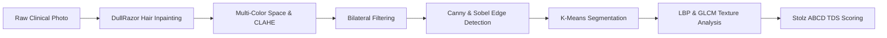

# ClinicalVision 2.0: Automated Visual Triage System for Skin Lesions 🔬

[](https://www.python.org/)
[](https://fastapi.tiangolo.com/)
[](https://opencv.org/)
[](https://manipal.edu/mit.html)

A high-performance, explainable computer vision pipeline and clinical triage dashboard for dermatological lesion assessment, developed as part of **CSE 3176: Foundations of Computer Vision Lab (Labs 1–5)** at **Manipal Institute of Technology, Manipal**.

---

## 👨‍💻 Team Details & Academic Credentials

- **Rajit Mohan Shrivastava** (Reg. No. 240962378, Roll No. 24) — AIML-B
- **Prayatshu Misra** (Reg. No. 240962386, Roll No. 32) — AIML-B
- **Eknoor Singh Chhabra** (Reg. No. 240962412, Roll No. 58) — AIML-B
- **Faculty In-Charge / Examiner:** Dr. Roopalakshmi R, Associate Professor, School of Computer Engineering, MIT Manipal.
- **Academic Year:** 2026–2027 (Semester 5)

---

## What Is This Project?

ClinicalVision 2.0 is an automated visual triage system that processes skin lesion images using foundational computer vision techniques. It combines image enhancement, noise reduction, edge detection, segmentation, texture analysis and the Stolz ABCD scoring framework to generate an explainable risk assessment.

The system is intended as an educational and preliminary triage-support prototype, not a replacement for professional dermatological diagnosis.

## 📑 Deliverables & Submission Index

- **Official Submission Word Report:** `FCV_MiniProject_Report.docx`
- **Complete Markdown Report:** `REPORT.md`
- **Viva Voce Defense Guide:** `VIVA_PREPARATION.md`
- **Interactive Jupyter Notebook:** `SkinTriage_Notebook.ipynb`
- **Interactive Web Triage UI:** `static/index.html`

---

## 🌟 Technical Pipeline & Syllabus Mapping (Labs 1–5)



### 1. Lab 1 — Image Basics & Multi-Color Space Transformations

- Converts RGB images into **CIE LAB** and **HSV** color spaces.
- Separates luminance from chromatic information.
- Analyzes LAB a* and b* channels and HSV hue and saturation to study lesion color characteristics.

### 2. Lab 2 — Spatial Domain Intensity Transformations

- **CLAHE:** Applies Contrast Limited Adaptive Histogram Equalization (`clipLimit=2.0`, 8 × 8 grid) on the L* channel.
- Compares Min-Max Contrast Stretching, Global Histogram Equalization and Gamma Correction.

### 3. Lab 3 — Spatial Filtering & Artifact Suppression

- **DullRazor:** Uses morphological black top-hat transformation to identify dark hair strands, followed by Telea inpainting.
- **Bilateral Filtering:** Reduces noise while preserving important lesion boundaries.

### 4. Lab 4 — Edge Detection & Morphological Geometry

- **Canny Edge Detection:** Gaussian smoothing, Sobel derivatives, non-maximum suppression and hysteresis thresholding.
- **Morphological Operations:** Opening and closing to refine binary masks.
- **Geometric Analysis:** Contour extraction, convex hulls, rotated bounding boxes and spatial moments.

### 5. Lab 5 — Segmentation, Texture Descriptors & Clinical TDS

- **3D K-Means:** Segments lesions using color-space clustering.
- **Local Binary Patterns (LBP):** Extracts texture characteristics using rotation-invariant LBP (P=24, R=3).
- **GLCM:** Computes contrast, dissimilarity, homogeneity, energy and correlation.
- **Stolz ABCD Rule:** Calculates the Total Dermoscopy Score (TDS):

\[
TDS = 1.3A + 0.1B + 0.5C + 0.5D
\]

Where:
- **A — Asymmetry:** 0–2
- **B — Border Irregularity:** 0–8
- **C — Color Variegation:** 1–6
- **D — Diameter:** 1–5

Risk stratification:
- Benign: TDS < 4.75
- Suspicious: 4.75 ≤ TDS < 5.45
- High Risk: TDS ≥ 5.45

---

## 📊 Experimental Results on Clinical Cases

| Clinical Case | Asymmetry | Border | Color | Diameter | TDS | Risk Stratification |
|---|---:|---:|---:|---:|---:|---|
| Malignant Melanoma | 2/2 | 7/8 | 5/6 | 5/5 | **6.60** | High Risk |
| Benign Melanocytic Nevus | 0/2 | 1/8 | 2/6 | 2/5 | **2.00** | Low Risk |
| Basal Cell Carcinoma | 1/2 | 5/8 | 3/6 | 3/5 | **4.80** | Suspicious |
| Seborrheic Keratosis | 1/2 | 4/8 | 2/6 | 3/5 | **4.20** | Low Risk |

*These are prototype evaluation cases and scores, not clinically validated diagnostic outcomes.*

---

## Future Scope & Real-World Use Cases

- Evaluation on larger and more diverse dermatological image datasets.
- Improved robustness across lighting conditions and skin tones.
- Integration with clinical workflows as a preliminary triage-support tool.
- Further validation with dermatologists and medical professionals.
- Enhanced explainability and performance evaluation.

## 🚀 Quickstart Guide

### 1. Environment Installation

Ensure Python 3.11+ is installed.

```bash
pip install -r requirements.txt
```

### 2. Launch the Web Dashboard

```bash
python -m uvicorn api:app --reload --port 8000
```

Open: http://127.0.0.1:8000

### 3. Test Built-in Clinical Cases

Use the sample buttons in the dashboard to test:
- Malignant Melanoma
- Benign Melanocytic Nevus
- Basal Cell Carcinoma
- Seborrheic Keratosis

### 4. Export Clinical Dossier

After analyzing an image, use the dashboard's export functionality if available to generate a printable clinical dossier.

### 5. Interactive Jupyter Notebook

Open `SkinTriage_Notebook.ipynb` in VS Code or JupyterLab and execute the cells for the Labs 1–5 walkthrough.

---

## 📁 Repository Structure

```text
SkinConditionsTriageSystem/
├── api.py
├── utils.py
├── generate_report.py
├── generate_samples.py
├── build_notebook.py
├── FCV_MiniProject_Report.docx
├── REPORT.md
├── VIVA_PREPARATION.md
├── SkinTriage_Notebook.ipynb
├── requirements.txt
├── static/
│   ├── index.html
│   ├── style.css
│   ├── script.js
│   └── samples/
│       ├── melanoma.jpg
│       ├── benign_nevus.jpg
│       ├── basal_cell.jpg
│       └── seborrheic_keratosis.jpg
├── figures/
└── references.bib
```

## 🛠️ Built With

- **Python 3.11+**
- **FastAPI & Uvicorn** — Backend API
- **OpenCV & Scikit-Image** — Computer vision processing
- **HTML, CSS & JavaScript** — Frontend dashboard
- **Chart.js** — Data visualization
- **Jupyter Notebook** — Interactive experimentation

---

**Academic Project | CSE 3176 — Foundations of Computer Vision | MIT Manipal**